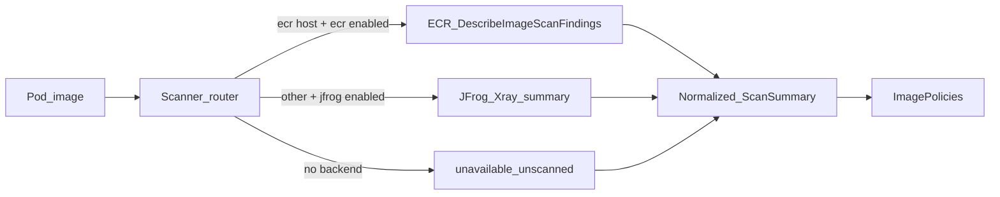

# Scan backends — JFrog Xray and Amazon Inspector (ECR)

KATANA evaluates image vulnerability posture at admission (and on **Evaluate**) using one or more **scan backends**. Policies only see a normalized summary: severity counts, `scanned`, and lookup status (`indexed` / `not_indexed` / `unavailable`).

## Supported backends

| Backend | When used | Credentials | Status API |
|---------|-----------|-------------|------------|
| **JFrog Xray** | Non-ECR image registries (Artifactory, Docker Hub proxies, etc.) | `JFROG_URL` + `JFROG_TOKEN` | `GET /api/v1/integrations/jfrog` |
| **Amazon Inspector (ECR)** | Private ECR hosts matching `*.dkr.ecr.<region>.amazonaws.com` | AWS default chain (**IRSA recommended**) + `AWS_REGION` | `GET /api/v1/integrations/ecr` |

Both can be enabled at once. Routing is by **image registry host**, not by merging two scans for the same image.



## Settings → Integrations (UI)

Admins configure (persisted in SQLite `app_settings`, not in the browser as secrets):

1. **Scanners** — toggles for JFrog Xray and Amazon Inspector (ECR).
2. **Allowed registries** — host list (one per line). Saving this **syncs** the **Registry Allowlist** ImagePolicy (`registry-allowlist`). An empty list disables that policy.

Defaults when nothing has been saved yet: each backend is enabled if it looks configured from the environment (JFrog URL/token present, or AWS region/credentials present).

## Amazon ECR / Inspector

### What KATANA does

- Calls ECR **`DescribeImageScanFindings`** (enhanced / Inspector findings when the registry uses enhanced scanning).
- Maps severity counts into the same shape as Xray (`critical` / `high` / `medium` / `low`).
- Sets `lookup_status`:
  - `indexed` — scan complete with findings payload
  - `not_indexed` — no completed scan for that image/tag/digest
  - `unavailable` — auth/API error, or scan still `IN_PROGRESS` / `PENDING` (admission does **not** wait for a new scan)

KATANA **does not** call `StartImageScan`. Images must already be scanned (e.g. scan-on-push + enhanced scanning on the repository).

### Credentials (cluster)

Prefer **IRSA** on the `katana` ServiceAccount:

```yaml
apiVersion: v1
kind: ServiceAccount
metadata:
  name: katana
  namespace: katana-system
  annotations:
    eks.amazonaws.com/role-arn: arn:aws:iam::ACCOUNT:role/katana-ecr-read
```

Minimum IAM actions (scoped to your repos where possible):

- `ecr:GetAuthorizationToken`
- `ecr:DescribeImageScanFindings`, `ecr:DescribeImages`, `ecr:DescribeRepositories`, `ecr:BatchGetImage`, …
- Optional: `inspector2:ListFindings` (extra detail; not required for the basic counts path)

Set region on the Deployment:

```yaml
env:
  - name: AWS_REGION
    value: eu-west-1
  - name: AWS_DEFAULT_REGION
    value: eu-west-1
```

Static access keys work for labs (`AWS_ACCESS_KEY_ID` / `AWS_SECRET_ACCESS_KEY`) but IRSA is the production path.

### ECR-only mode (common)

1. Leave `JFROG_URL` / `JFROG_TOKEN` empty (or disable JFrog in Settings).
2. Enable **Amazon Inspector (ECR)** in Settings → Integrations.
3. Add your ECR registry host(s) under **Allowed registries**.
4. Confirm `GET /api/v1/integrations/ecr` shows `configured` + `reachable`.
5. Evaluate an image such as  
   `123456789012.dkr.ecr.eu-west-1.amazonaws.com/my-app:1.2.3`  
   — expect `scan.scanner=ecr_inspector` and `lookup_status=indexed` once the scan is complete.

### Ephemeral E2E on AWS

Disposable Terraform (ECR + optional small EKS): [`deploy/e2e-aws/README.md`](../deploy/e2e-aws/README.md). Always `destroy.sh` when finished.

## JFrog Xray

See the [JFrog Xray data model](../README.md#jfrog-xray-data-model) in the main README (`internal/jfrog`). Used for every non-ECR registry when the JFrog toggle is enabled.

## Metrics

| Metric | Meaning |
|--------|---------|
| `katana_scan_lookups_total{scanner,status}` | Lookups by `jfrog` / `ecr_inspector` and status |
| `katana_xray_lookups_total{status}` | Legacy alias for JFrog only |
| `katana_jfrog_up` / `katana_ecr_up` | Backend configured gauges |

Fleet “scan coverage” aggregates these series — see [`FLEET.md`](./FLEET.md).

## Policy interaction

- **Require Scanned Image** — denies when `scanned=false` or the lookup is `unavailable` (fail-closed).
- **Block Critical / Block High in Prod** — use highest severity from whichever backend returned `indexed`.
- **Registry Allowlist** — independent of scanners; keep it in sync via Settings → Integrations or edit the policy directly.
